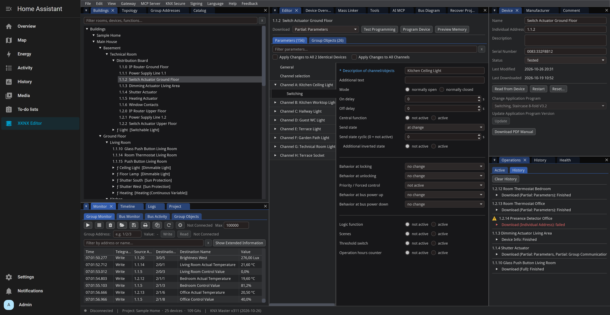
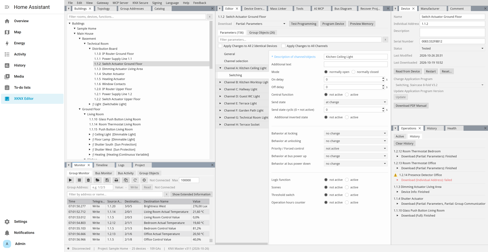

# XKNX Editor for Home Assistant

This integration runs [XKNX Editor](https://github.com/XKNX/xknx-editor), the KNX project editor, on your Home Assistant server and shows it in the sidebar. It works with Home Assistant OS and with Home Assistant Container, which can't install apps.





## Installation

1. Open **Settings** > **Marketplace** in Home Assistant, search for **XKNX Editor** and install it.
2. Restart Home Assistant.
3. Add the integration under **Settings** > **Devices & services** > **Add integration** > **XKNX Editor**.

Until XKNX Editor is listed in the Marketplace, add it from its GitHub link first: in **Settings** > **Marketplace**, choose **Custom repositories** in the menu at the top right and add `https://github.com/XKNX/xknx-editor-ha-integration` with the type **Integration** (this asks you to connect GitHub first). With Home Assistant 2026.10, which has no Marketplace yet, do the same in [HACS](https://hacs.xyz), also with **Custom repositories** in its menu at the top right.

On its first start, the integration installs the editor into an environment of its own. That takes a few minutes and needs internet access. Until it's done, the **XKNX Editor** panel in the sidebar shows the progress.

## How It Works

- **A process of its own.** The editor runs next to Home Assistant, in its own Python environment, with exactly the package versions it was released with. Home Assistant's own packages aren't changed. The environment uses Home Assistant's Python and is installed again when Home Assistant moves to another Python version.
- **Administrators by default.** The panel and the MCP server are available to Home Assistant administrators, and the editor is reachable only through Home Assistant's sign-in. An option opens both to all users (see below).
- **Keys from your KNX authoring tool.** The editor reads the signing key, the project-log key and the MyKNX sign-in from the tool's assemblies you upload, with a .NET runtime. The integration installs Microsoft's .NET 10 runtime for it next to the editor (a 37 MB download, checked by its checksum).
- **Your files.** The editor's settings, product catalog and file folder are in `xknx_editor` in your configuration folder and are part of Home Assistant's backups. Its environment is in `.cache/xknx_editor`, which backups leave out; it's installed again when it's missing.

## Connecting to the KNX Bus

The editor connects to your KNX/IP interface or router itself, next to Home Assistant's KNX integration, so the interface needs a free tunnel. Searching for interfaces and KNX/IP routing (multicast) need Home Assistant's network: with Home Assistant Container, run it with `network_mode: host`.

## AI Assistants (MCP)

The editor's MCP server lets AI assistants such as Claude or Codex read and edit the project. In Home Assistant it's reachable through Home Assistant itself, at `https://<your Home Assistant>/api/xknx_editor/mcp`, so it uses Home Assistant's HTTPS and remote access and needs no port of its own. AI tools sign in with a long-lived access token of a Home Assistant administrator, or of any user with **Editor for all users** (your profile > **Security** > **Long-lived access tokens**), for example:

```bash
claude mcp add --transport http xknx-editor https://<your Home Assistant>/api/xknx_editor/mcp \
  --header "Authorization: Bearer <token>"
```

The editor's **AI MCP** tab shows the address and the commands for Claude Code and Codex.

## Options

Under the integration's **Configure**:

- **Editor for all users:** users who aren't administrators see XKNX Editor in the sidebar too, and can use its MCP server with their own long-lived access token. The editor has no roles of its own: everyone who uses it can change the project and program devices on the KNX bus.
- **Requirements file:** leave it empty. It only exists to try an editor build before its release, as a URL or a path on the Home Assistant host.

## License

Apache License 2.0. XKNX Editor itself is licensed under the GNU General Public License v2.0 and runs as a separate program.
